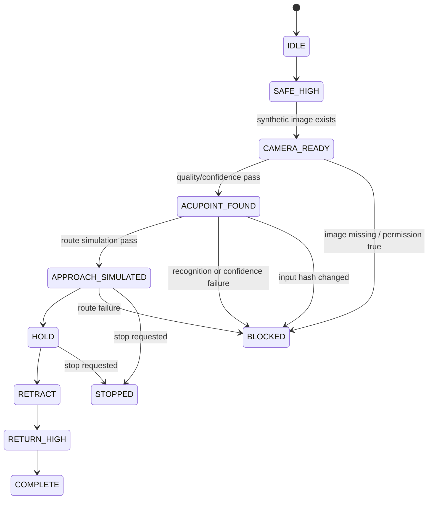

# B5 Demo：离线拍照到非接触流程演示

这是毕业课题简化版的纯软件 DEMO。`scripts/b5_demo_flow.py` 接收合成图片、离线视觉识别 JSON、合成路线 JSON 和 `left`/`right` 侧别，输出一份确定性的审计 JSON。它不调用现有控制 API，也不导入串口、D405、共享内存或部署运行时。

## 运行

```bash
python3 scripts/b5_demo_flow.py \
  --image tests/fixtures/b5_demo/capture.frame \
  --vision tests/fixtures/b5_demo/vision.json \
  --route tests/fixtures/b5_demo/route-left.json \
  --side left \
  --output docs/progress/evidence/B5/DEMO/nominal-left.json
```

右侧只需将 `--route` 换成 `route-right.json` 并设置 `--side right`。正常输出的 `current_stage` 为 `COMPLETE`，`valid=true`，并包含图像 SHA-256、穴点坐标、仿真末端目标、非接触偏移和返回高位目标。

## 状态图



## 安全输出

所有输出固定为：

```text
execution_allowed=false
entity_action_authorized=false
nano_deployment_authorized=false
entity_serial_accessed=false
entity_d405_accessed=false
motor_enabled=false
motor_zeroed=false
motor_moved=false
```

图片缺失、视觉质量/置信度失败、路线失败、声明哈希不匹配和权限字段为 `true` 都进入 `BLOCKED` 并返回非零退出码。`--stop-after APPROACH_SIMULATED` 或 `--stop-after HOLD` 用于离线演示 `STOPPED` 分支。

## 验证

```text
python3 -m unittest -v tests/test_b5_demo_flow.py
Ran 8 tests ... OK
```

测试覆盖正常左右路径、图片缺失、穴点识别/置信度失败、路线失败、输入哈希变化、权限解锁、主动停止、确定性 ID 和无硬件依赖。
