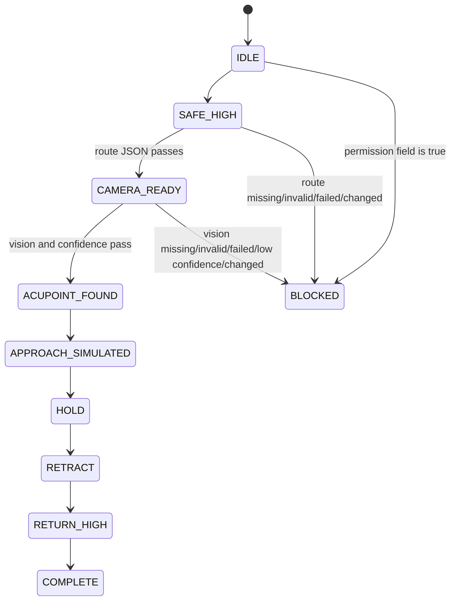

# B5 Demo：路线与视觉离线闭环

本 DEMO 将 2 号的 `b5.m1-m2-sim.v1` 路线 JSON 和 3 号的
`b5.vision-offline.v1` 视觉 JSON 适配成确定性的只读演示报告。适配器只读文件，
不调用生产者、不发送 HTTP 请求、不访问串口/D405/共享内存，也不产生电机指令。

## 答辩运行

左侧演示：

```bash
python3 scripts/b5_demo_adapter.py \
  --route docs/progress/evidence/B5/DEMO/route-left-from-b5-m1-m2.json \
  --vision docs/progress/evidence/B5/DEMO/vision-from-b5-vision.json \
  --side left \
  --expected-route-sha256 a99feb5da0591246b8d6a69934ec5f594d016c486a13a81923a73d1f95ed9323 \
  --expected-vision-sha256 be04071f94aab72d91ea69294bf28bfc6f1f95d511b802f2da99402f31991c64 \
  --output /tmp/b5-demo-left.json
```

右侧将路线改为 `route-right-from-b5-m1-m2.json`，`--side right`，路线 SHA-256
改为 `1b0762f6c3f9ec8fccf1a621b06a1310d98e471da198c24275930e7f653bf187`。
正常输出显示侧别、穴点、候选末端位置、`simulation_only=true` 和
`final_state=COMPLETE`。输入 JSON 来自 2 号和 3 号的已核验 schema/示例；本任务只保存
输出 JSON，未合并两个分支。

## 状态图



## 失败与安全

路线 `FAIL_CLOSED`、视觉失败、坐标置信度低于 `0.55`、输入 SHA-256 变化、格式错误、
缺少安全字段或任一权限字段为 `true` 均进入 `BLOCKED` 并返回非零退出码。
所有输出固定包含：

```text
execution_allowed=false
entity_action_authorized=false
nano_deployment_authorized=false
entity_serial_accessed=false
entity_d405_accessed=false
motor_command_generated=false
motor_enabled=false
motor_zeroed=false
motor_moved=false
```

`COMPLETE` 仅表示离线状态机走完，不表示实体执行许可。旧的独立 fixture 入口
`scripts/b5_demo_flow.py` 保留用于回归测试；答辩闭环使用 `b5_demo_adapter.py`。

## 验证

```bash
python3 -m unittest -v tests/test_b5_demo_flow.py tests/test_b5_demo_adapter.py
python3 -m py_compile scripts/b5_demo_flow.py scripts/b5_demo_adapter.py tests/test_b5_demo_flow.py tests/test_b5_demo_adapter.py
git diff --check
```
